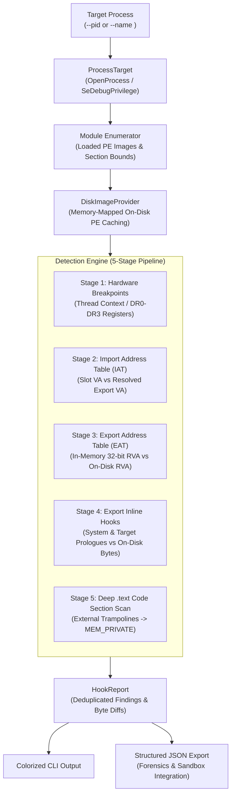

# hook-detector

Autonomous, high-performance runtime hook detection and PE integrity verification engine for Windows x64 processes. Compares live in-memory execution against original on-disk binaries to expose inline hooks, trampoline detours, IAT/EAT tampering, and hardware breakpoints with zero false positives.



---

## Key Architectural Guarantees

- **Differential On-Disk PE Verification**: Employs `DiskImageProvider` with memory-mapped PE caching to compare live executable bytes directly against compiler output on disk, capturing both patched bytes and original code.
- **Multi-Module & Auto-Detection**: Automatically discovers and deep-scans all application-local modules without manual listing (`--all-game-modules`), with support for comma-separated module filtering (`--module client.dll,scenesystem.dll`).
- **System Library Exclusion (`--no-system`)**: Filters out OS-level libraries (`ntdll.dll`, `kernel32.dll`, `user32.dll`) to focus exclusively on target application hooks without system overlay noise.
- **Zero False-Positives on Data Exports**: Validates 32-bit RVAs in the Export Address Table and bypasses non-executable sections (`.rdata`), eliminating false detections caused by C++ vtables and ASLR relocations.
- **Comprehensive Trampoline Recognition**: Identifies 5-byte `jmp rel32` (`E9`), 14-byte `jmp [rip+0]` (`FF 25 00 00 00 00`), 6-byte `jmp [rip+disp32]`, and 12-byte `mov rax, imm64; jmp rax`.
- **Target Memory Classification**: Validates jump destinations using `VirtualQueryEx` to detect redirections targeting private allocated memory (`MEM_PRIVATE`), shellcode pages, or foreign unlisted binaries.

---

## Real-World Battle Test (Windows x64 Process / Game Engine)

Evaluated against a live game process (`cs2.exe`) running with active third-party injected detours:

| Module | Hook Type | Detected Count | Redirect Target / Description |
| :--- | :--- | :--- | :--- |
| **`client.dll`** | `inline_hook` | **21** | Trampolines in `.text` pointing to unmapped `MEM_PRIVATE` memory |
| **`scenesystem.dll`** | `inline_hook` | **6** | Trampolines in `.text` pointing to unmapped `MEM_PRIVATE` memory |
| **`inputsystem.dll`** | `inline_hook` | **1** | Input dispatch detour |
| **`gameoverlayrenderer64.dll`** | `inline_hook` | **3** | Steam Overlay render pipeline hooks |
| **`USER32.dll`** | `inline_hook` | **28** | Message & cursor hooks (`SetCursorPos`, `ShowCursor`, `PeekMessageW`) |
| **`KERNEL32.DLL`** | `inline_hook` | **4** | Memory management detours (`VirtualAlloc`, `VirtualProtect`, `LoadLibraryA/W`) |
| **`ntdll.dll`** | `inline_hook` | **1** | System call hook (`NtOpenFile`) |

Total scan duration across 40+ loaded libraries: **~3.2 seconds**.

---

## Directory Layout

```
hook-detector/
├── CMakeLists.txt              # C++20 CMake build configuration
├── README.md                   # Technical reference & architecture
├── .gitignore                  # Build artifact exclusions
├── include/
│   └── hook_detector/
│       ├── core/
│       │   ├── types.h         # Core structures (ModuleInfo, MemoryRange)
│       │   ├── privileges.h    # SeDebugPrivilege token elevation
│       │   ├── process_target.h# Process memory reader & thread enumerator
│       │   └── pe_image.h      # Memory PE parser & DiskPeImage provider
│       ├── scanners/
│       │   ├── hw_breakpoint_scanner.h # DR0-DR3 debug register monitor
│       │   ├── iat_scanner.h   # Import Address Table analyzer
│       │   ├── eat_scanner.h   # Export Address Table RVA verifier
│       │   ├── inline_hook_scanner.h   # Function prologue disassembly & diffing
│       │   ├── pattern_scanner.h       # Byte signature & mask matching
│       │   └── vtable_scanner.h        # Virtual method table validator
│       └── report/
│           ├── hook_report.h   # Structured findings aggregator & console output
│           └── json_exporter.h # ISO 8601 forensic JSON export
├── src/
│   ├── main.cpp                # CLI orchestrator & multi-stage pipeline
│   ├── core/
│   │   ├── privileges.cpp
│   │   ├── process_target.cpp
│   │   └── pe_image.cpp
│   ├── scanners/
│   │   ├── hw_breakpoint_scanner.cpp
│   │   ├── iat_scanner.cpp
│   │   ├── eat_scanner.cpp
│   │   ├── inline_hook_scanner.cpp
│   │   ├── pattern_scanner.cpp
│   │   └── vtable_scanner.cpp
│   └── report/
│       ├── hook_report.cpp
│       └── json_exporter.cpp
└── third_party/
    └── nlohmann/
        └── json.hpp            # Single-header JSON serialization
```

---

## Toolchain Prerequisites

- **C++ Compiler**: C++20 compliant MSVC (Visual Studio 2022+ / Build Tools 17+ or 18+).
- **Operating System**: Windows 10 / Windows 11 x64.
- **Build System**: CMake >= 3.20.
- **Windows SDK Libraries**: `Advapi32.lib`, `User32.lib`.

---

## Build Instructions

### 1. Build via CMake (Recommended)

```powershell
# Configure build directory
cmake -B build -S . -DCMAKE_BUILD_TYPE=Release

# Build executable
cmake --build build --config Release
```

The compiled binary will be placed in `bin/hook_detector.exe`.

### 2. Direct Compilation via MSVC Command Prompt

```powershell
# In x64 Native Tools Command Prompt for VS:
cl /std:c++20 /O2 /W4 /EHsc /utf-8 /DUNICODE /D_UNICODE /Iinclude /Ithird_party `
   src\core\*.cpp src\scanners\*.cpp src\report\*.cpp src\main.cpp `
   /Fe:bin\hook_detector.exe /link /SUBSYSTEM:CONSOLE Advapi32.lib User32.lib
```

---

## CLI Options & Usage

```
Usage:
  hook_detector.exe --pid <ProcessID> [options]
  hook_detector.exe --name <ProcessName.exe> [options]

Options:
  --module, -m <name>      Target module(s) for deep scanning (comma-separated or multiple)
  --all-game-modules       Target all non-system game/application modules (default)
  --all-modules            Target all loaded modules without exception
  --no-system              Exclude Windows system modules (ntdll, kernel32, user32, etc.)
  --json <file_path>       Export scan results to JSON file
  --help, -h               Display this help message
```

### Examples

#### Scan process by name across all game modules (excluding OS noise):
```powershell
.\bin\hook_detector.exe --name cs2.exe --no-system
```

#### Scan specific modules and save report to JSON:
```powershell
.\bin\hook_detector.exe --name cs2.exe --module client.dll,scenesystem.dll --json report.json
```

#### Full process scan by PID:
```powershell
.\bin\hook_detector.exe --pid 15752 --json audit.json
```

---

## Sample Output

```text
----------------------------------------------------------------------
 Finding #55 [critical]
 Type:            inline_hook
 Target Module:   scenesystem.dll
 Target Function: func_prologue_0x239792
 Resolved Via:    pattern_scan
 Address:         0x7ffea445b8b0
 Redirect To:     0x7ffe93be0a95
 Captured Bytes:  E9 E0 51 78 EF 50 10 48 89 48 08 55 53 56 57 41
 Expected Bytes:  48 8B C4 48 89 50 10 48 89 48 08 55 53 56 57 41
 Details:         External jmp rel32 (E9) targeting private executable memory (MEM_PRIVATE)
----------------------------------------------------------------------
```
